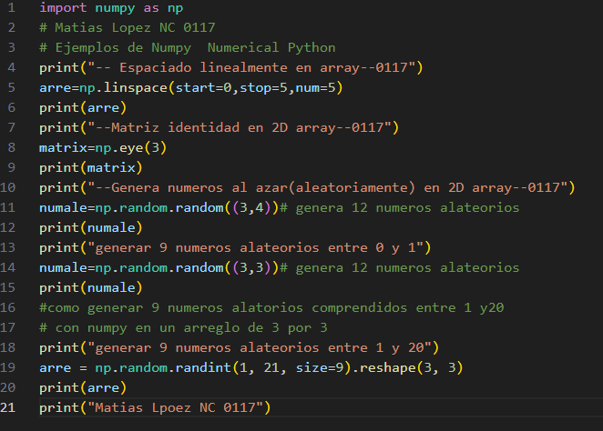
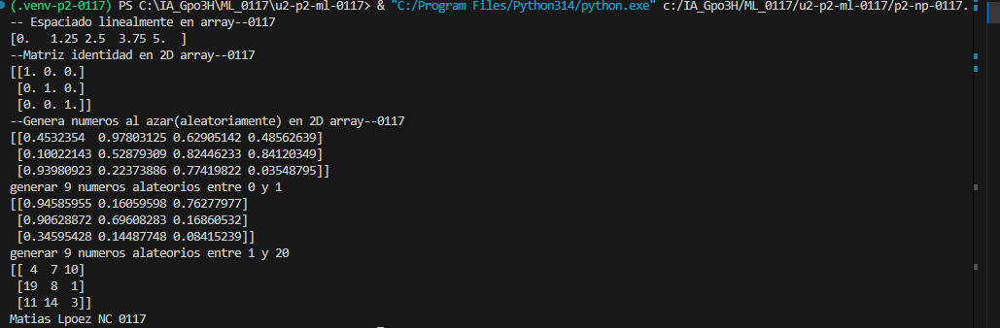

start=0: indica el valor inicial del arreglo, que es 0.
stop=1: indica el valor final del arreglo, que es 1. Este valor se incluye por defecto.
num=5: indica que se generarán 5 números en total, distribuidos uniformemente entre 0 y 1.

## que hace np. linspace
linspace sirve para crear una secuencia de números con una separación igual entre ellos

## El codigo

## Resultado

